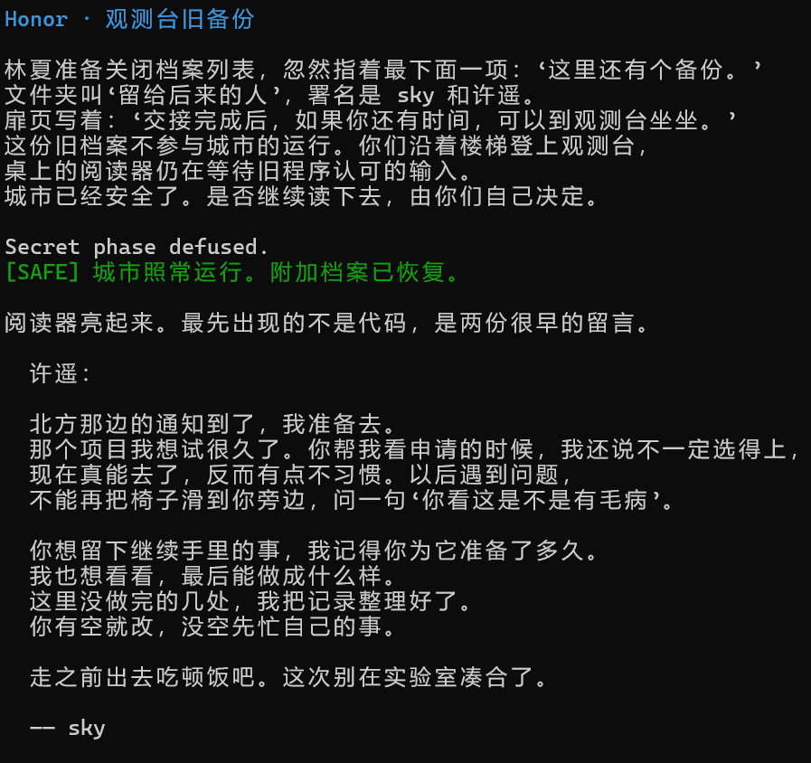
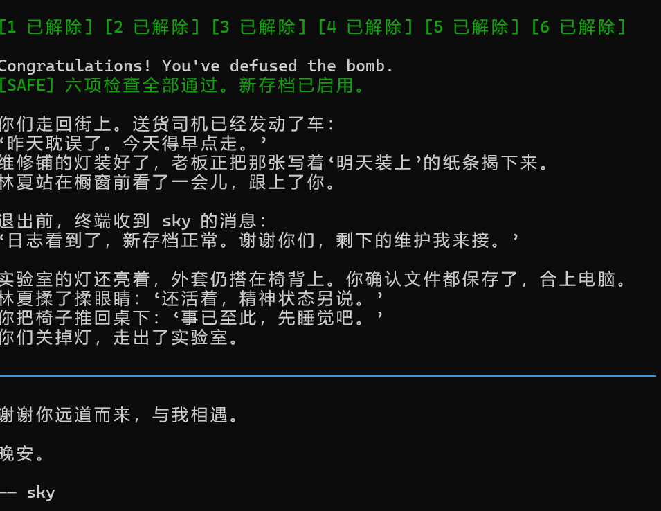
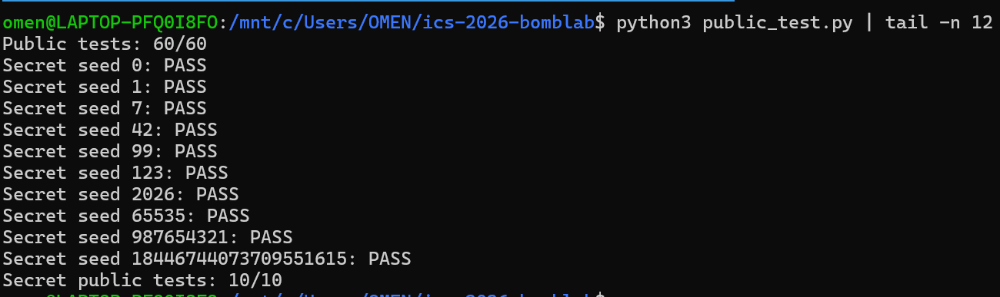

# BombLab 实验报告

## 1. 实验目标与分析方法

本实验要求根据个人 `bomb` 的 x86-64 反汇编，恢复各关由 64 位 `challenge` 计算口令的规则，并在 `defuser.c` 中实现通用于不同 seed 的求解函数。答案不能写死为某个 seed 对应的一组常数。

我主要使用 `objdump` 查看个人炸弹中的 `phase_01`、`phase_02`、`phase_03` 及其辅助函数。分析时遵循 System V AMD64 调用约定：前两个整型或指针参数通常通过 `%rdi/%rsi` 传递，32 位部分对应 `%edi/%esi`，整型返回值放在 `%eax`。由于这些关卡大量使用 32 位寄存器，计算结果应按 `uint32_t` 理解，即只保留低 32 位；逻辑右移则使用无符号数实现。

为便于下文表示，记：

- `C` 为 64 位无符号数 `challenge`；
- `u32(x)` 表示只保留 `x` 的低 32 位；
- `^` 表示按位异或；
- `>>` 表示无符号逻辑右移。

## 2. 第 1 关：函数调用、参数传递与返回值

### 2.1 输入格式与总体验证流程

`phase_01` 先以参数 `1` 调用 `valid_u32_fields`，说明输入必须恰好包含一个 32 位无符号十进制整数。随后用 `sscanf` 读出该数，并把 `challenge` 传给 `p1_compute`：

```asm
4020d8: mov    %r12,%rdi
4020db: call   402050 <p1_compute>
4020e0: cmp    %eax,-0x14(%rbp)
4020e3: sete   %al
```

因此，本关口令就是 `p1_compute(challenge)` 的 32 位返回值。

### 2.2 `p1_compute` 的参数拆分

`p1_compute` 开始处对 `challenge` 制作了三份副本：

```asm
402055: mov    %rdi,%rax
402058: mov    %rdi,%rdx
40205b: mov    %edi,%r8d
40205e: shr    $0x20,%rax
402062: shr    $0x10,%rdx
402066: mov    %eax,%r9d
402069: mov    %eax,%esi
```

据此定义：

```text
L = u32(C)          // challenge 的低 32 位
H = u32(C >> 32)    // challenge 的高 32 位
M = u32(C >> 16)    // challenge 右移 16 位后留下的低 32 位
```

这里 `%r8d` 保存 `L`，`%r9d` 保存 `H`，而 `%rdx` 右移 16 位后，其 `%edx` 对应 `M`。

### 2.3 三个辅助函数

第一个辅助函数为：

```asm
<p1_step0>:
    lea    (%rdi,%rsi,8),%eax
    xor    $0x63ac,%eax
    ret
```

`lea (%rdi,%rsi,8)` 在这里不是取地址，而是完成 `rdi + 8*rsi` 的整数运算。因此：

```text
s0 = u32(L + 8H) ^ 0x63ac
```

第二个辅助函数为：

```asm
<p1_step1>:
    lea    (%rdi,%rdi,2),%eax
    add    $0xe1cb,%esi
    xor    %esi,%eax
    ret
```

`lea (%rdi,%rdi,2)` 得到 `3*rdi`。调用前 `%edi` 中放的是 `H`，`%esi` 中放的是 `M`，所以：

```text
s1 = u32(3H) ^ u32(M + 0xe1cb)
```

第三个辅助函数为：

```asm
<p1_step2>:
    lea    0x2b86(%rsi),%eax
    xor    %edi,%eax
    ret
```

调用前 `%edi` 为 `s1`，`%esi` 为 `L`，故：

```text
s2 = u32(L + 0x2b86) ^ s1
```

最后一条关键指令为：

```asm
40208b: xor    %ecx,%eax
```

其中 `%ecx` 保存第一次调用得到的 `s0`，而 `%eax` 保存 `s2`，所以最终答案为：

```text
answer = s2 ^ s0
```

对应的 C 语言核心实现是：

```c
uint32_t low = (uint32_t)challenge;
uint32_t high = (uint32_t)(challenge >> 32);
uint32_t middle = (uint32_t)(challenge >> 16);

uint32_t step0 = (low + high * 8u) ^ 0x63acu;
uint32_t step1 = (high * 3u) ^ (middle + 0xe1cbu);
uint32_t step2 = (low + 0x2b86u) ^ step1;
values[0] = step2 ^ step0;
```

### 2.4 非公开 seed 验证

选取不在 `tests/public.json` 中的 seed `314159`。炸弹给出的本关 challenge 为：

```text
C = 0xd85dda4696932a2d
L = 0x96932a2d
H = 0xd85dda46
M = 0xda469693
s0 = 0x59819ff1
s1 = 0x535ef68c
s2 = 0xc5cda33f
answer = 2622241998
```

把 `defuser` 输出的 `2622241998` 输入个人炸弹后，得到 `Phase 1 defused.`。

## 3. 第 2 关：数组、循环与递推关系

### 3.1 输入个数与首项

`phase_02` 以参数 `6` 调用 `valid_u32_fields`，并检查 `sscanf` 的返回值是否为 6，因此本关需要输出 6 个 32 位无符号整数，记为 `x[0]` 到 `x[5]`。

首项检查对应的关键汇编为：

```asm
40215a: mov    %r13,%rax
40215d: mov    -0x40(%rbp),%esi
402160: shr    $0x2b,%rax
402164: add    %eax,%eax
402166: and    $0x3e,%eax
402169: add    $0x13,%eax
40216c: cmp    %eax,%esi
```

`0x2b = 43`，`0x3e = 62`，`0x13 = 19`，因此：

```text
x[0] = (((C >> 43) * 2) & 0x3e) + 0x13
```

### 3.2 循环变量与递推式

首项通过后，程序设置：

```asm
402170: mov    $0x12,%ecx    # shift = 18
402175: mov    $0x1,%edx     # i = 1
```

循环体为：

```asm
40217a: mov    %r13,%rax
40217d: lea    (%rsi,%rsi,2),%esi
402180: shr    %cl,%rax
402183: and    $0x1f,%eax
402186: add    %edx,%eax
402188: xor    %esi,%eax
40218a: mov    -0x40(%rbp,%rdx,4),%esi
40218e: cmp    %eax,%esi
402192: add    $0x1,%rdx
402196: add    $0x5,%ecx
402199: cmp    $0x6,%rdx
40219d: jne    40217a
```

各寄存器含义为：

- `%edx` 是数组下标 `i`，从 1 增长到 5；
- `%ecx` 是右移位数 `shift`，初值 18，每轮增加 5；
- `%esi` 在每轮开始时保存前一项 `x[i-1]`；
- `lea (%rsi,%rsi,2)` 计算 `3*x[i-1]`；
- `(C >> shift) & 0x1f` 每次抽取 challenge 中连续的 5 个比特。

所以对 `1 <= i <= 5`，递推关系为：

```text
shift(i) = 18 + 5(i - 1)
part(i)  = (C >> shift(i)) & 0x1f
x[i]     = u32(3 * x[i-1]) ^ (part(i) + i)
```

循环末尾先令 `i += 1`、`shift += 5`，再判断 `i != 6`，因此实际使用的移位量依次为 `18, 23, 28, 33, 38`，恰好产生后五项。

对应的 C 语言核心实现是：

```c
values[0] = (uint32_t)((((challenge >> 43) * 2u) & 0x3eu) + 0x13u);

uint32_t shift = 18u;
for (uint32_t i = 1; i < 6; ++i) {
    uint32_t part = (uint32_t)((challenge >> shift) & 0x1fu);
    values[i] = (values[i - 1] * 3u) ^ (part + i);
    shift += 5u;
}
```

### 3.3 非公开 seed 验证

对 seed `314159`，本关 challenge 为 `0x049392bee0cdfbbd`。抽取到的五个 `part` 依次为：

| `i` | `shift` | `part(i)` | `x[i]` |
| ---: | ---: | ---: | ---: |
| 0 | — | — | 55 |
| 1 | 18 | 19 | 177 |
| 2 | 23 | 1 | 528 |
| 3 | 28 | 14 | 1569 |
| 4 | 33 | 31 | 4672 |
| 5 | 38 | 10 | 14031 |

因此 `defuser` 输出：

```text
55 177 528 1569 4672 14031
```

输入个人炸弹后得到 `Phase 2 defused.`。

## 4. 第 3 关：`switch` 分支与跳转表

### 4.1 两个输入及公共计算

`phase_03` 要求输入两个 32 位无符号整数。设它们为 `index` 和 `answer`。程序先计算：

```asm
4022fc: mov    %r12d,%edi
402301: and    $0x7,%edi
402304: cmp    %edi,-0x18(%rbp)
```

故第一个数必须是：

```text
index = u32(C) & 7
```

接下来程序构造传给 `p3_dispatch` 的第二个参数：

```asm
402309: mov    %r12,%rax
40230c: mov    %r12,%rsi
40230f: shr    $0x3,%rax
402313: shr    $0x20,%rsi
402317: xor    %eax,%esi
402319: call   402250 <p3_dispatch>
```

由于异或发生在 `%eax/%esi` 两个 32 位寄存器上，公共中间量为：

```text
mixed = u32(C >> 32) ^ u32(C >> 3)
```

随后调用 `p3_dispatch(index, mixed)`，其返回值必须等于第二个输入 `answer`。

### 4.2 跳转表恢复

`p3_dispatch` 的关键部分如下：

```asm
402254: mov    %edi,%eax
402256: mov    %esi,%edi
402258: cmp    $0x7,%eax
40225b: ja     4022a2
40225d: notrack jmp *0x405820(,%rax,8)
```

`index` 用作跳转表下标，每个表项占 8 字节。逐项查看表中目标以及目标处的跳转，可恢复出下列并非按函数编号顺序排列的映射：

| `index` | 实际目标 | 由目标函数恢复出的 `answer` |
| ---: | --- | --- |
| 0 | `p3_case_5` | `u32(5 * mixed + 0x2ac29)` |
| 1 | `p3_case_4` | `u32(3 * mixed + 0xe428)` |
| 2 | `p3_case_1` | `u32(2 * mixed) ^ 0xc087` |
| 3 | `p3_case_6` | `(mixed ^ 0x2f90) + (mixed >> 2)` |
| 4 | `p3_case_3` | `u32(5 * mixed + 0x16df0)` |
| 5 | `p3_case_7` | `u32(4 * mixed) ^ 0x7e34` |
| 6 | `p3_case_0` | `(mixed ^ 0xd25d) + (mixed >> 1)` |
| 7 | `p3_case_2` | `u32(3 * mixed + 0xd107)` |

例如 `p3_case_7` 的汇编为：

```asm
<p3_case_7>:
    lea    0x0(,%rdi,4),%eax
    xor    $0x7e34,%eax
    ret
```

因此该分支对应 `u32(4*mixed) ^ 0x7e34`。其余分支同样可由 `lea` 的比例因子、立即数加法、异或和逻辑右移直接翻译得到。

实现时先用 `switch (index)` 按上述映射选择公式，最后依次输出 `index` 与 `answer`。

### 4.3 非公开 seed 验证

对 seed `314159`，本关 challenge 为：

```text
C = 0x1cd4d8174d7decfd
index = C & 7 = 5
mixed = 0xf57b6588
```

`index = 5` 应选择 `p3_case_7`：

```text
answer = u32(4 * 0xf57b6588) ^ 0x7e34
       = 0xd5ede814
       = 3589138452
```

所以 `defuser` 输出：

```text
5 3589138452
```

输入个人炸弹后得到 `Phase 3 defused.`。

## 5. 第 4 关：递归调用与返回过程

### 5.1 输入格式与递归函数参数

`phase_04` 以参数 `1` 调用 `valid_u32_fields`，并检查 `sscanf` 的返回值是否为 1，因此本关只需要输出一个 32 位无符号整数。输入解析成功后，入口函数用 `challenge` 构造 `p4_walk` 的四个参数：

```asm
4023e8: mov    rcx,r12
4023eb: mov    rax,r12
4023ee: mov    edi,r12d
4023f1: xor    esi,esi
4023f3: shr    rax,0x20
4023f7: shr    rcx,0x7
4023fb: and    edi,0x7f
4023fe: mov    edx,0x7f
402403: xor    ecx,eax
402405: call   402330 <p4_walk>
```

按照 System V AMD64 调用约定，四个 32 位整数参数依次位于 `%edi`、`%esi`、`%edx`、`%ecx`。因此调用关系为：

```text
target = u32(C) & 0x7f
low    = 0
high   = 127
key    = u32(C >> 7) ^ u32(C >> 32)

answer = p4_walk(target, low, high, key)
```

`target` 一定处于 `[0, 127]`，所以递归搜索从完整区间开始，而且一定能遇到终止条件。

### 5.2 中点计算与终止条件

`p4_walk` 的参数含义为：

```text
%edi = target
%esi = low
%edx = high
%ecx = key
```

函数开头先把 `target` 备份到 `%eax`，再计算中点：

```asm
402334: mov    eax,edi
402336: mov    edi,edx
402338: sub    edi,esi
40233a: shr    edi,1
40233c: add    edi,esi
40233e: cmp    edi,eax
402340: je     402390
```

此时 `%edi` 不再保存第一个参数，而是保存：

```text
mid = low + ((high - low) >> 1)
```

因为 `low <= high` 且各变量为无符号数，这就是区间中点。若 `mid == target`，程序跳到终止分支：

```asm
402390: lea    eax,[rdi+0x63]
402393: xor    eax,ecx
402395: ret
```

因此递归基例为：

```text
F(target, low, high, key) = u32(mid + 0x63) ^ key
                            （当 target == mid）
```

### 5.3 左右递归分支

目标值不等于中点时，程序先保存一个本层计算需要使用的临时量：

```asm
402347: lea    ebx,[rdi+rcx]
```

即：

```text
temp = u32(mid + key)
```

接着比较 `target` 和 `mid`：

```asm
40234e: cmp    eax,edi
402350: jb     402370
```

Intel 语法的 `cmp eax,edi` 按 `target - mid` 设置标志。`jb` 是无符号“小于”跳转，因此跳到 `0x402370` 表示 `target < mid`；相等情况已经提前返回，所以顺序执行的分支表示 `target > mid`。

当 `target > mid` 时，低边界改为 `mid + 1`：

```asm
402352: lea    esi,[rdi+0x1]
402355: mov    edi,eax
402357: call   402330 <p4_walk>
40235c: lea    eax,[rax+rax*2]
40235f: xor    eax,ebx
402366: xor    eax,0x15
```

`lea eax,[rax+rax*2]` 将递归返回值乘以 3。因此右分支为：

```text
child = F(target, mid + 1, high, key)
result = u32(3 * child) ^ temp ^ 0x15
```

当 `target < mid` 时，高边界改为 `mid - 1`：

```asm
402370: lea    edx,[rdi-0x1]
402373: mov    edi,eax
402375: call   402330 <p4_walk>
40237a: lea    eax,[rax+rax*2]
40237d: xor    eax,ebx
402384: xor    eax,0xf
```

所以左分支为：

```text
child = F(target, low, mid - 1, key)
result = u32(3 * child) ^ temp ^ 0x0f
```

递归返回时，每一层都会把下一层结果乘以 3，再混入本层的 `mid + key` 和一个表示方向的常数。这样即使搜索到同一个基例，不同路径也会产生不同结果。

对应的 C 语言核心实现为：

```c
static uint32_t p4_walk(uint32_t target,
                        uint32_t low,
                        uint32_t high,
                        uint32_t key)
{
    uint32_t mid = low + (high - low) / 2u;

    if (mid == target) {
        return (mid + 0x63u) ^ key;
    }

    uint32_t temp = mid + key;
    uint32_t result;

    if (target > mid) {
        result = p4_walk(target, mid + 1u, high, key);
        result = result * 3u;
        result ^= temp;
        result ^= 0x15u;
    } else {
        result = p4_walk(target, low, mid - 1u, key);
        result = result * 3u;
        result ^= temp;
        result ^= 0x0fu;
    }

    return result;
}
```

### 5.4 非公开 seed 验证

继续使用不在 `tests/public.json` 中的 seed `314159`。本关得到：

```text
C      = 0x6a9e8d40d5354fbc
target = 60
key    = 0xeb34e7df
```

递归访问的中点和方向依次为：

```text
63（左）→ 31（右）→ 47（右）→ 55（右）
→ 59（右）→ 61（左）→ 60（命中）
```

基例在 `mid = 60` 时返回 `0xeb34e740`。随后逐层返回并执行各层的乘 3、异或 `mid + key` 以及方向常数，最外层最终得到：

```text
answer = 0x94d638d8 = 2497067224
```

`defuser` 输出 `2497067224`，输入个人炸弹后得到 `Phase 4 defused.`。

## 6. 第 5 关：结构体布局、指针与链表遍历

### 6.1 两个输入的含义

`phase_05` 以参数 `2` 调用 `valid_u32_fields`，随后用 `sscanf` 读取两个无符号整数。关键比较为：

```asm
4024cc: lea    rsi,[rbp-0x14]
4024d0: mov    rdi,r12
4024d3: call   402420 <p5_traverse>
4024d8: mov    edx,eax
4024dc: cmp    DWORD PTR [rbp-0x1c],edx
4024e1: mov    eax,DWORD PTR [rbp-0x14]
4024e4: cmp    DWORD PTR [rbp-0x18],eax
```

`p5_traverse(challenge, &last_data)` 的返回值与第一个输入比较，写入 `last_data` 的值与第二个输入比较。因此本关应输出：

```text
result last_data
```

### 6.2 恢复节点结构与入口表

`p5_traverse` 对节点指针 `%rdx` 的访问方式为：

```asm
402447: mov    esi,DWORD PTR [rdx+0x4]
40244c: xor    eax,DWORD PTR [rdx]
402464: mov    rdx,QWORD PTR [rdx+0x8]
```

因此每个节点占 16 字节，结构可恢复为：

```c
typedef struct P5Node {
    uint32_t value;              // 偏移 0
    uint32_t data;               // 偏移 4
    const struct P5Node *next;   // 偏移 8
} P5Node;
```

例如 `0x405ba0` 处的 16 字节为：

```text
e14e0000 0c030000 005c4000 00000000
```

x86-64 使用小端序，所以该节点的 `value = 0x4ee1`、`data = 0x030c`，`next = 0x405c00`。按相同方式恢复 `p5_nodes` 的 12 个节点：

| 节点 | 地址 | `value` | `data` | `next` |
| ---: | --- | ---: | ---: | ---: |
| 0 | `0x405ba0` | `0x4ee1` | `0x030c` | 6 |
| 1 | `0x405bb0` | `0xa3fb` | `0x047e` | 3 |
| 2 | `0x405bc0` | `0xf8fc` | `0x0a78` | 4 |
| 3 | `0x405bd0` | `0xf187` | `0x0154` | 0 |
| 4 | `0x405be0` | `0x7e3f` | `0x0234` | 11 |
| 5 | `0x405bf0` | `0x8371` | `0x0636` | 2 |
| 6 | `0x405c00` | `0x7a0b` | `0x091a` | 7 |
| 7 | `0x405c10` | `0xd130` | `0x006a` | 10 |
| 8 | `0x405c20` | `0x4762` | `0x072d` | 5 |
| 9 | `0x405c30` | `0x50c4` | `0x0539` | 8 |
| 10 | `0x405c40` | `0xec3e` | `0x0b5b` | `NULL` |
| 11 | `0x405c50` | `0xf83b` | `0x080a` | 1 |

函数用 challenge 的低 3 位选择 `0x405b60` 处的头指针：

```asm
40242d: and    eax,0x7
402434: mov    rdx,QWORD PTR [rax*8+0x405b60]
```

入口表的顺序为：

| `challenge & 7` | 0 | 1 | 2 | 3 | 4 | 5 | 6 | 7 |
| ---: | ---: | ---: | ---: | ---: | ---: | ---: | ---: | ---: |
| 起始节点 | 9 | 8 | 5 | 2 | 4 | 11 | 1 | 3 |

### 6.3 遍历次数与结果累积

函数首先计算：

```text
index = u32(C) & 7
steps = u32(C >> 3) & 3
node  = heads[index]
```

初始节点的处理对应：

```asm
40243c: mov    rax,rdi
40243f: shr    rdi,0x20
402443: shr    rax,0x6
402447: mov    esi,DWORD PTR [rdx+0x4]
40244a: xor    eax,edi
40244c: xor    eax,DWORD PTR [rdx]
402450: xor    eax,0x1f1
402455: mov    DWORD PTR [r8],esi
402458: add    eax,esi
```

所以初值为：

```text
result = u32(C >> 6) ^ u32(C >> 32)
         ^ node->value ^ 0x1f1
result = u32(result + node->data)
last_data = node->data
```

随后 `steps = 0` 时直接返回；否则每轮执行：

```asm
402464: mov    rdx,QWORD PTR [rdx+0x8]
40246b: mov    esi,DWORD PTR [rdx+0x4]
40246e: xor    eax,DWORD PTR [rdx]
402470: add    eax,esi
402472: mov    DWORD PTR [r8],esi
```

等价于：

```text
node = node->next
result = u32((result ^ node->value) + node->data)
last_data = node->data
```

循环恰好沿 `next` 再移动 `steps` 次，所以包括起始节点在内共处理 `steps + 1` 个节点。

### 6.4 非公开 seed 验证

对非公开 seed `314159`：

```text
C = 0xd2b58ef282236824
index = 4
steps = 0
heads[4] = node 4
node 4: value = 0x7e3f, data = 0x0234 = 564
```

本次不需要继续沿链表移动。代入初始公式得到：

```text
result = 0x18bd7ed0 = 415071952
last_data = 564
```

因此输出 `415071952 564`，个人炸弹显示 `Phase 5 defused.`。

## 7. 第 6 关：函数指针表与间接调用

### 7.1 入口函数和公共中间量

`phase_06` 要求输入一个无符号整数，并将它与 `p6_dispatch(challenge)` 比较：

```asm
402618: mov    rdi,r12
40261b: call   402580 <p6_dispatch>
402620: cmp    DWORD PTR [rbp-0x14],eax
```

`p6_dispatch` 首先计算公共输入：

```asm
402589: mov    rbx,rdi
40258c: shr    rdi,0x6
402590: mov    rax,rbx
402593: shr    rax,0x20
402597: xor    edi,eax
```

所以：

```text
x = u32(C >> 6) ^ u32(C >> 32)
```

同时，函数从 challenge 中取出两个三位索引：

```text
index1 = u32(C) & 7
index2 = (u32(C) >> 3) & 7
```

汇编中的 `%ebx & 0x38` 没有再右移，是因为函数指针每项恰好占 8 字节；位 3～5 的值本身就等于 `index2 * 8`。

### 7.2 六个运算函数

六个小函数都接收一个 `uint32_t` 并返回一个 `uint32_t`：

| 函数 | 关键指令 | 恢复出的计算 |
| --- | --- | --- |
| `p6_op_0` | `shl 5`、`lea x+4x` | `((x << 5) + 0xfe42) ^ (5*x)` |
| `p6_op_1` | `lea x+0x89aa`、`shr 5` | `(x + 0x89aa) ^ (x >> 5)` |
| `p6_op_2` | `xor 0x4e5d`、`shl 7` | `(x ^ 0x4e5d) + (x << 7)` |
| `p6_op_3` | `shr 3`、`xor x` | `(x ^ (x >> 3)) + 0x3a57` |
| `p6_op_4` | `ror eax,1` | 32 位循环右移 1 位 |
| `p6_op_5` | `rol eax,7` | 32 位循环左移 7 位后异或 `0xd0d5` |

其中循环移位不能简单写成普通右移或左移。例如：

```c
ror1(x) = (x >> 1) | (x << 31);
rol7(x) = (x << 7) | (x >> 25);
```

### 7.3 函数指针表和两次分派

第一次间接调用为：

```asm
4025a3: and    eax,0x7
4025a6: call   QWORD PTR [rax*8+0x405e00]
```

第二次调用为：

```asm
4025a0: and    ebx,0x38
4025ad: xor    eax,0x12df
4025b2: mov    edi,eax
4025b4: call   QWORD PTR [rbx+0x405e00]
4025bf: add    eax,0x2778
```

读取 `0x405e00` 处的 8 个函数地址，得到实际表序：

| 索引 | 0 | 1 | 2 | 3 | 4 | 5 | 6 | 7 |
| ---: | ---: | ---: | ---: | ---: | ---: | ---: | ---: | ---: |
| 函数 | `op_4` | `op_1` | `op_0` | `op_2` | `op_5` | `op_5` | `op_3` | `op_1` |

完整关系为：

```text
r1 = ops[index1](x)
r2 = r1 ^ 0x12df
r3 = ops[index2](r2)
answer = u32(r3 + 0x2778)
```

### 7.4 非公开 seed 验证

对 seed `314159`：

```text
C = 0xc1a32713817bbecc
x = 0x8fa6c9e8
index1 = 4  -> p6_op_5
index2 = 1  -> p6_op_1
```

逐步计算为：

```text
p6_op_5(x)       = 0xd3642492
0xd3642492 ^ 0x12df = 0xd364364d
p6_op_1(0xd364364d) = 0xd5ff9e45
answer = 0xd5ff9e45 + 0x2778
       = 0xd5ffc5bd
       = 3590309309
```

个人炸弹显示 `Phase 6 defused.`，随后显示六关全部解除。

## 8. Honor：字符串门、栈上复制与混合运算

### 8.1 `secret_gate` 对整行字符串的检查

Honor 输出不只是三个整数。`secret_gate` 先将输入复制到一个清零的栈缓冲区，再检查固定偏移：

```asm
402769: mov    rdi,rbx
40276c: call   strlen
402771: sub    rax,0x24
402775: cmp    rax,0x7f
402779: jbe    402790
...
402790: mov    rsi,rbx
402793: mov    rdi,r12
402796: call   402710 <secret_copy>
40279b: cmp    DWORD PTR [rbp-0xb0],0x4e45504f
```

`secret_copy` 每轮复制一个字节，直到连同结尾的 `\0` 一起复制完毕。局部缓冲区起点为 `[rbp-0xd0]`，而比较位置 `[rbp-0xb0]` 与起点相差 `0x20 = 32` 字节。立即数 `0x4e45504f` 在小端序内存中的字节为 `4f 50 45 4e`，即字符串 `OPEN`。

因此输入必须满足：

- 前 32 字节作为填充；
- 偏移 32 处恰好为 `OPEN`；
- `secret_phase` 从偏移 `0x24 = 36` 处开始解析后面的内容；
- 总长度满足门函数的范围检查。

实现中选择 32 个字符 `A` 作为填充，构造：

```text
AAAAAAAAAAAAAAAAAAAAAAAAAAAAAAAAOPEN a b c
```

### 8.2 `secret_mix`

`secret_phase` 接收三个参数：待解析的字符串、Honor 的 `challenge` 以及由前六行答案计算出的 `context`。辅助函数为：

```asm
402634: mov    eax,edi
402636: rol    eax,0x3
402639: add    eax,0xb160
40263e: xor    eax,0x37d1
```

故：

```text
secret_mix(v) = (rol32(v, 3) + 0xb160) ^ 0x37d1
```

### 8.3 三个整数的恢复

设 `C` 为 Honor challenge，`K` 为 context，并定义：

```text
C_lo = u32(C)          C_hi = u32(C >> 32)
K_lo = u32(K)          K_hi = u32(K >> 32)
x = C_hi ^ C_lo
y = K_hi ^ K_lo
```

第一个数来自：

```asm
4026b0: mov    ecx,r13d
4026b5: and    ecx,0x3
4026b8: cmp    DWORD PTR [rbp-0x2c],ecx
```

所以：

```text
a = K_lo & 3
```

第二个数的关键计算为：

```asm
4026c0: imul   r9d,ecx,0xb160
4026d8: shr    r13,0x10
4026de: xor    r9d,r13d
4026e1: xor    edi,r8d
4026e4: call   secret_mix
4026e9: xor    eax,r9d
```

因此：

```text
r9 = u32(a * 0xb160) ^ u32(K >> 16)
b  = secret_mix(x ^ y) ^ r9
```

调用 `secret_mix` 后，`%eax` 经异或得到 `b`。最后一项使用调用前保存在 `%esi` 和 `%r8d` 中的 `x`、`y`：

```asm
4026f1: shr    esi,0x3
4026f4: lea    edx,[r8+rcx+0x37d1]
4026fc: add    edx,esi
4026fe: xor    eax,edx
```

所以：

```text
c = b ^ u32(y + a + 0x37d1 + (x >> 3))
```

所有运算均按 32 位无符号数处理。

### 8.4 非公开 seed 验证

对 seed `314159`，在 `solve_secret` 入口只读观察到：

```text
C = 0xe124832cd7bf0c69
K = 0x53e476c844d60faf
```

中间值为：

```text
a = 3
x = 0x369b8f45
y = 0x17327967
r9 = 0x76ca50f6
secret_mix(x ^ y) = 0x0d5055a0
b = 0x7b9a0556 = 2073691478
c = 0x659c2675 = 1704732277
```

最终第七行为：

```text
AAAAAAAAAAAAAAAAAAAAAAAAAAAAAAAAOPEN 3 2073691478 1704732277
```

将前六行和该行一起输入个人炸弹后，依次出现 `Congratulations! You've defused the bomb.` 与 `Secret phase defused.`。

Honor 运行结果如下：



## 9. 编译与测试结果

在 WSL 环境中重新编译：

```bash
make clean
make
```

编译成功，没有触发 `-Werror`。执行 `python3 public_test.py` 后：

- 第 1 关：公开 seed 10/10 通过；
- 第 2 关：公开 seed 10/10 通过；
- 第 3 关：公开 seed 10/10 通过；
- 第 4 关：公开 seed 10/10 通过；
- 第 5 关：公开 seed 10/10 通过；
- 第 6 关：公开 seed 10/10 通过；
- 六个常规关卡总计 `60/60`；
- Honor 公开测试 `10/10` 通过。

此外，使用公开列表之外的 seed `314159` 运行全部关卡，结果如下：

```text
Phase 1 challenge: 0xd85dda4696932a2d
2622241998
Phase 1 defused.

Phase 2 challenge: 0x049392bee0cdfbbd
55 177 528 1569 4672 14031
Phase 2 defused.

Phase 3 challenge: 0x1cd4d8174d7decfd
5 3589138452
Phase 3 defused.

Phase 4 challenge: 0x6a9e8d40d5354fbc
2497067224
Phase 4 defused.

Phase 5 challenge: 0xd2b58ef282236824
415071952 564
Phase 5 defused.

Phase 6 challenge: 0xc1a32713817bbecc
3590309309
Phase 6 defused.
Congratulations! You've defused the bomb.

Honor challenge: 0xe124832cd7bf0c69
Honor context:   0x53e476c844d60faf
AAAAAAAAAAAAAAAAAAAAAAAAAAAAAAAAOPEN 3 2073691478 1704732277
Secret phase defused.
```

六个常规关卡全部通过的运行结果如下：



公开测试结果如下：



## 10. 参考资料与辅助工具说明

### 10.1 参考资料

1. [课程 BombLab 实验说明](https://ics-26fall-fdu.github.io/labs/lab2-bomb-lab/)
2. [个人 BombLab 仓库](https://github.com/ghoneimnorwin-sys/ics-2026-bomblab)
3. 个人 `bomb` 的本地反汇编结果，以及仓库中的 `README.md`、`tests/public.json`。

### 10.2 工具使用说明

- `objdump -d`、`objdump -s`：提取个人炸弹的汇编、函数指针表、头指针表和链表节点原始数据。
- GDB：仅以断点和寄存器查看方式确认 Honor 的 `challenge` 与 `context`，未使用 `set` 修改炸弹内部状态。
- WSL、GCC 与 Make：重新编译 `defuser.c`，确认代码在 `-Werror` 选项下能够通过编译。
- `public_test.py` 和个人 `bomb`：分别进行公开 seed 测试和非公开 seed `314159` 的逐关验证。
- Codex：用于核对汇编分析和测试结果。

